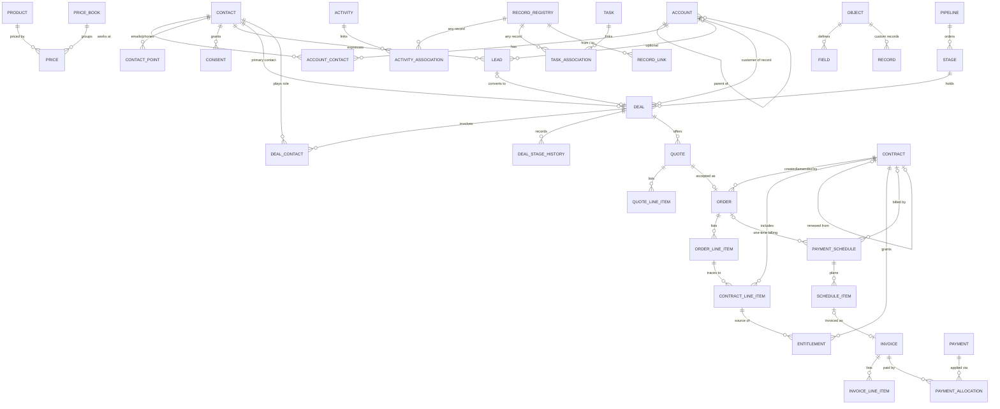
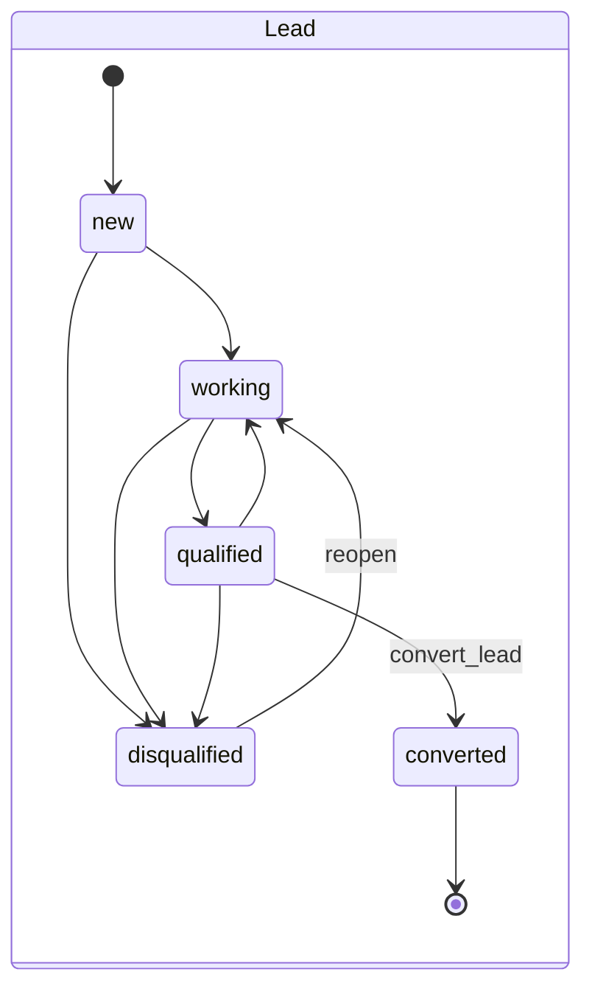

# Data model

Status: **Core and Sales are built** (migrations exist), and so are **quotes and orders**, the first part of Commerce ([ADR 0014](decisions/0014-quotes-and-orders.md); see [Quotes and orders as built](#quotes-and-orders-as-built)). **The rest of Commerce (products, prices, price books) and Post-sale and billing are designed, not built:** sections 5.4 and 5.5, the quote, order, contract, entitlement, payment schedule, invoice and payment state machines in section 6, and the operations that use them in section 7 describe a future design. No tables, API routes or tools exist for them yet (see [`ROADMAP.md`](../ROADMAP.md)). Everything here follows the platform rules: tenant isolation, the API as the single source of truth, and the admin/ops split.

Contents:

1. Design goal: a model tenants can make their own
2. How data is stored
3. Conventions
4. Entity-relationship diagram
5. Tables
6. State machines
7. Lifecycle operations
8. Integrity, privacy and compliance
9. Indexes, scale and search
10. Design decisions (billing, B2C customers, renewals, currency and tax, usage, stages)
11. Deliberate differences and deferred work
12. Scope decisions

---

## 1. Design goal: a model tenants can make their own

The standard objects are a **starting point, not a cage.** Whoever gets access to a workspace should be able to reshape it for their business without asking us. Self-hosters also get the source code under an open-source license and can change anything.

There is only one limit on that freedom. It exists so the lifecycle operations, money and audit trail keep working: **a field that a lifecycle operation depends on can be relabeled or hidden, but not deleted or retyped.** If a tenant doesn't want that behavior at all, they turn off the module that contains it.

### What a tenant can change (through the API, admin MCP or `crm` CLI)

| Change | Standard objects | Custom objects |
|---|---|---|
| Rename (relabel) the object and any field | ✅ | ✅ |
| Add custom fields of any type, including relations | ✅ | ✅ |
| Hide fields from default views, summaries and MCP output | ✅ | ✅ |
| Make optional fields required; add defaults and validation rules | ✅ | ✅ |
| Edit picklists (industries, sources, roles, account types, activity types, and so on) | ✅ | ✅ |
| Define their own statuses, each mapped to a system category (see §6) | ✅ leads, lifecycle stages, deal pipelines and stages | ✅ optional status field with their own transitions |
| Relate any object to any other object | ✅ | ✅ |
| Turn whole modules on or off (see below) | ✅ | n/a |
| Change lifecycle behavior settings (for example "accepting a quote marks the deal won") | ✅ | n/a |
| Delete or retype core fields that lifecycle operations use | ❌ relabel or hide instead | n/a (every field is theirs) |
| Edit issued financial documents (sent quotes, orders, issued invoices, recorded payments) | ❌ create a new version, void or refund instead | n/a |
| Bypass tenant isolation or the audit log | ❌ never | ❌ never |

### Modules

Standard objects come in modules, so a tenant uses only what fits their business. A coaching business might use **Core** and **Sales** only. A SaaS company might turn everything on.

| Module | Objects | Depends on | Status |
|---|---|---|---|
| **Core** (always on) | Contact, Account, AccountContact, Activity, Task | none | Built |
| **Sales** | Lead, Pipeline, Stage, Deal, DealContact, DealStageHistory | Core | Built |
| **Commerce** | Quote, QuoteLineItem, Order, OrderLineItem (built); Product, Price, PriceBook (designed) | Sales | Quotes and orders built |
| **Post-sale and billing** | Contract, ContractLineItem, Entitlement, PaymentSchedule, ScheduleItem, Invoice, InvoiceLineItem, Payment, PaymentAllocation | Commerce | Designed, not built |

**New workspaces start with every available module turned on.** Today that means Core, Sales and Commerce. When the commerce modules are built, Commerce and Post-sale and billing are on by default for new workspaces too. Existing workspaces get a migration that turns them on, which is harmless because a module with no records changes nothing.

**Designing around the commerce modules without building them.** The Commerce and billing tables in §5.4 and §5.5 are designed now, so the current model doesn't make choices that building them would have to undo. In particular:

- `leads.interest_product_id` is a plain nullable `uuid` today, and would get its foreign key to `products` in the migration that adds the Commerce module.
- The deal's amount is entered by hand today. The Commerce module would add "amount = total of the primary quote" as the default, with the existing override.
- The `customer of record` pattern, money columns, number sequences, `external_ids`, immutability triggers and status categories are all built, because Core and Sales use them too.
- The lifecycle categories `customer` and `former_customer` are set manually today. With the Post-sale module they would be derived from contracts.

When a module is turned off, its tables still exist (with no rows), but its objects disappear from schema discovery and OpenAPI. Its API routes return `404 module_disabled`, and its MCP tools are hidden. Turning a module off is only allowed while it has no records (an explicit, audited `--archive-records` option is planned, not built). The setting lives on the workspace and is part of the schema document (`modules:`) that `crm schema pull` and `apply` work with.

### Custom objects are easy

A custom object is created in one call, with its fields in the same request (`POST /v1/objects`, or the admin MCP `create_object` tool). With schema-as-code it is an entry in the schema file that `crm schema apply` creates; the full format is in [`docs/cli.md`](cli.md#the-file-format):

```yaml
# crm.schema.yaml (excerpt)
objects:
  - name: property
    label: Property
    plural_label: Properties
    id_prefix: prop          # IDs look like prop_01J…
    display_field: address
    owned: true              # adds an owner field
    fields:
      - { name: address, type: text, required: true }
      - { name: bedrooms, type: number }
      - { name: list_price, type: currency }
      - name: status
        type: status
        values: [{ key: listed, label: Listed }, { key: under_offer, label: Under offer }, { key: sold, label: Sold }]
        initial: listed
        transitions: { listed: [under_offer], under_offer: [listed, sold] }
      - { name: seller, type: relation, relation: { to: contact } }
      - { name: buyer_deal, type: relation, relation: { to: deal, cardinality: many_to_one } }
```

As soon as it is created, a custom object gets the same things a standard object gets, with no deploy:

- REST endpoints at `/v1/objects/property/records`, with the full query language, idempotency and If-Match support.
- The tenant's OpenAPI spec (`GET /v1/openapi.json`), regenerated from their schema, so coding agents can generate typed clients.
- Generic MCP tools that take an `object` argument (`query_records`, `create_record` and so on), plus discovery through `describe_object`. Adding objects never multiplies the number of MCP tools.
- Activity and task timelines, search, automations, alerts, webhooks, events and audit entries.
- Relations to and from any standard or custom object.

---

## 2. How data is stored

Standard objects need **typed core columns.** Custom data is stored as **JSONB**. The model uses both, each where it fits:

| | Standard objects | Custom objects |
|---|---|---|
| Table | One typed table per object (`contacts`, `deals`, `invoices`, …), created by our migrations | The shared `records` table, keyed by `object_id` |
| Core fields | Real columns with types, `NOT NULL`, CHECK constraints and foreign keys | n/a |
| Custom fields | `custom jsonb` column, validated against field metadata | `data jsonb`, validated against field metadata |
| Restricted custom fields | `custom_encrypted jsonb` (encrypted per field, see [the threat model](security/threat-model.md)) | `encrypted jsonb` |
| Relations | Real composite foreign keys | `record_links`, with foreign keys to `record_registry` on both ends |

- **Why typed tables for standard objects:** money, dates, states and relations between financial documents need database-level guarantees (composite foreign keys, immutability triggers, CHECK constraints). JSONB can't provide those.
- **Why JSONB for custom fields and objects:** tenants change their schema at runtime, and DDL must never be driven by customer input.
- **`record_registry`:** every record of every type, standard or custom, has one row `(tenant_id, id, object_id)`, written by trigger. Activity and task associations and custom relations point at it with real foreign keys. That gives "link to any record" referential integrity without untyped JSON references, as the brief requires.
- **Metadata covers both.** Standard objects and their core fields are rows in `objects` and `fields` with `is_system = true`. Agents discover a Deal the same way they discover a Property.

### Field types

Each type's behaviour is declared once, in the field type registry (`TYPE_INFO` in `core/fieldtypes.ts`). Filters, sorts, cursors, aggregates, uniqueness, search text, CSV, retyping, `describe` and the OpenAPI document all read it. `test/fieldtypes.test.ts` runs every type through each layer from one table. A type added without a case there fails, and so does a type whose behaviour doesn't match what it declares. Values of every type are stored in the record's `custom`/`data` JSON, and a restricted field's in `custom_encrypted`/`encrypted`, encrypted per field.

| Type | Value (API) | Filter operators | Sort | Group by | Measures (besides count) | Unique | Search text | CSV |
|---|---|---|---|---|---|---|---|---|
| text | string (≤ 2,000) | eq, neq, in, not_in, contains, starts_with, is_null | first 200 characters | yes | none | yes | yes | text |
| long_text | string (≤ 100,000) | same as text | no | no | none | no | no | text |
| email, phone, url | string | same as text | yes | no | none | yes | yes | text |
| number | number (±10^15) | eq, neq, in, not_in, gt, gte, lt, lte, is_null | yes | no | sum, avg, min, max | yes | no | text |
| currency | number, major units | same as number | yes | no | sum, avg, min, max | no | no | text |
| boolean | true / false | eq, neq, in, not_in, is_null | yes | yes | none | no | no | text |
| date, datetime | ISO 8601 | same as number | yes | yes, bucketed | min, max | no | no | text |
| single_select, status | option key | eq, neq, in, not_in, starts_with, is_null | yes | yes | none | no | no | text |
| multi_select | list of option keys | contains, is_null | no | no | none | no | no | `;`-joined |
| relation | record ID (list for many-to-many) | eq, neq, in, not_in, is_null | no | many-to-one only | none | no | no | ID, or `field.lookup` on import |
| **address** | object of parts plus `display` | is_null; parts as text: `field.city eq …` | by parts | country, region, city | none | no | parts | one column per part |
| **json** | any JSON value | is_null; `field.key.key` eq, neq, is_null | no | no | none | no | no | one JSON cell |
| **rating** | whole number 1 to max | same as number | yes | yes | avg, min, max | no | no | text |
| **percent** | number, percentage points | same as number | yes | no | avg, min, max | no | no | text |
| **duration** | whole seconds | same as number | yes | no | sum, avg, min, max | no | no | text |

Every type can be `required`, take a `default` (checked when the field is saved), and be `restricted`, except relations. A restricted value is encrypted, comes back as `"[restricted]"` without `restricted:read`, and can never be filtered, sorted, grouped or measured (422), its parts and paths included. Safe retypes: text → long_text, number → currency, single_select → multi_select, and rating, percent or duration → number. The last three keep stored values as they are, and the old type's implicit bounds are written into the number field's `validation`, so stored values stay valid and new ones keep to them: a percent's 0 to 100, a duration's 0 and up, a rating's 1 to its max. A retype that a saved view relies on (grouping by a rating, which numbers can't be; sorting; a filter operator the new type lacks) names the shared views (and counts the personal ones) that will stop working, and needs the same confirmation as converting values (`confirm_token`, or `confirm_data_changes` in schema apply). Aggregates that group by the field are refused afterwards too. Nothing else changes type, including to or from address and json. A refused option, rule or value is always a 422, never a 500.

**address.** Input is an object with any of `line1`, `line2` (≤ 200 characters each), `city`, `region` (≤ 100), `postal_code` (≤ 20) and `country`, an ISO 3166-1 alpha-2 code. Any case is accepted and it is stored upper-case. The built-in list holds the 249 officially assigned codes, with no geocoding and no outside calls. Parts are trimmed, an empty part is dropped, and an address with no parts is empty (null). Each part is one line of plain text: control characters (C0 and C1), NUL, unpaired surrogates, the line and paragraph separators U+2028 and U+2029, and the bidi controls U+202A to U+202E and U+2066 to U+2069 are refused, and so are unknown keys (`__proto__` included). Lengths count characters as text fields do (UTF-16 code units). `display` is accepted on input and ignored, so a record read can be written back. Output always has all six parts (`null` when empty) plus `display`, one line made of line1, line2, city, region with postal code, and the country's English name, for example `1 Main St, Austin, TX 73301, United States`. `display` is a convenience for showing; the parts are the address. A part may itself hold `, ` (`Suite 5, Building B`), so never split `display` to get the parts back: nothing in the server parses it, and CSV carries one column per part, never `display`. Filter, sort and group by the parts as text fields, `hq.city`, `hq.country` and so on (`filter[hq.city]=Austin` in a URL). A country filter value is upper-cased. Sorting by the address itself is refused, with a hint to sort by `hq.country,hq.region,hq.city`, the documented order. Search text holds the parts, not the country's name. CSV export writes `hq.line1` … `hq.country`, and import reads them back. A new record gets the parts in its row. An update merges the part columns the file has into the stored address: a part cell with a value sets that part, an empty cell clears that part, and a part without a column keeps its stored value; a row whose part cells are all empty leaves the address as it is, as any empty cell leaves its field. A restricted address the caller can't read can only be imported whole (a column for every part), since there is nothing to merge into. Duplicate rules compare all parts, ignoring case and spacing. A merge or bulk update moves the address whole.

**json.** Any JSON value, for integrations and agents: at most 16 KB as Postgres stores and returns it (the jsonb text, in UTF-8 bytes, with its `", "` and `": "` separators and every number written out in full), 10 levels deep, and keys up to 200 characters. Postgres keeps a JSON number as an exact decimal, so `1e308` would be 309 digits on every read: a number must be within ±10^15 (as number fields) and at most 32 characters when written out without an exponent, which every ordinary number fits (all 17 significant digits JavaScript prints, and small numbers down to about 1e-30). Refused anywhere inside: the keys `__proto__`, `constructor` and `prototype`, NUL, unpaired surrogates, non-finite numbers and numbers past those bounds. `null` clears the field. An optional `options.shape` is a small declarative check, not JSON Schema: `type` (object, array, string, number, integer, boolean or null), `required` keys, `properties` (key → kind) and `additional_properties: false`, with at most 50 keys. It is checked on every write. Changing it with `update_field` (`shape`, or `null` to remove it) doesn't re-check stored values. Filters: `is_null` on the field, and `field.key.key` (1 to 4 keys or array indexes of letters, digits, `_` and `-`) with `eq`, `neq` or `is_null`, comparing a scalar (text up to 2,000 characters, a number within the bounds above, or true/false) as JSON. The comparison uses no index; its cost is bounded by the value size and the 5 s statement timeout. A URL carries only text, so there a value that is a JSON scalar is read as one: `filter[meta.a]=1` matches the number 1, `true` and `false` the booleans, and `null` a JSON null (missing keys too need `filter[meta.a][is_null]=true`); anything else, such as `abc` or `01`, matches that text. To match the text `"1"`, use `POST /v1/query`, where a body says which it means. A json field is never sorted, grouped, searched, unique, or matched by the duplicate finder (422). CSV is one cell of JSON text, guarded against spreadsheet formulas like any text.

**rating.** A whole number from 1 to `options.max` (1 to 10, default 5). Numeric text such as `"4"` is accepted. The max can be raised with `update_field` (`max`) but not lowered. Filters and sort work as for numbers, it can be grouped (keys are numbers), and avg, min and max apply.

**percent.** Percentage points: `12.5` means 12.5%, the same as `deal.probability`, in the API, CSV and aggregates alike. Input also takes text such as `"12.5%"` (filters too). Values are kept to 4 decimal places: more precision is refused (422), never rounded away, so `0.00001` is an error rather than 0. Values lie between `validation.min` and `validation.max`, which default to 0 and 100 and may be set from -10^9 to 10^9.

**duration.** Whole seconds, from 0 to 10^11. Input is a number of seconds, numeric text, or an ISO 8601 duration made of weeks, days, hours, minutes and whole seconds (`PT1H30M`, `P2W`, `P1DT2H`). Years and months are refused because they have no fixed length, and so are fractional seconds. Filters take the same forms. `validation.min` and `validation.max` are in seconds. The suggested display is compact, largest unit first, with zero units left out: `1d 2h 3m 4s`, `1h 30m`, `0s`.

**Files** are attached to records, not held in a field: see [Files and notes](#files-and-notes) below. A `file` field type is not built ([ADR 0011](decisions/0011-files-and-attachments.md)).

### Files and notes

**Files.** Any record of any object can have files attached (up to 100): a signed contract on a deal, a résumé on a candidate, a photo on a custom object's record. A file follows its record's object access: read on the object lists and downloads its files, write attaches and removes them. Knowing a file's ID gives nothing.

```sh
# Attach: the request body is the file's bytes, name= is its name
curl -s -X POST "localhost:8787/v1/records/deal_…/files?name=contract.pdf" -H "Authorization: Bearer $KEY" --data-binary @contract.pdf
curl -s localhost:8787/v1/records/deal_…/files -H "Authorization: Bearer $KEY"                 # list
curl -s -OJ localhost:8787/v1/files/file_…/content -H "Authorization: Bearer $KEY"            # download
curl -s -X DELETE localhost:8787/v1/files/file_… -H "Authorization: Bearer $KEY"              # remove
```

- **Limits.** 10 MB per file and 1 GB per workspace by default (`FILE_MAX_MB`, `FILE_QUOTA_MB`); `GET /v1/files/limits` shows them. The per-workspace figure is a workspace limit, so the operator can set another for one workspace, and an upload past it answers 409 `limit_reached` ([limits.md](limits.md)). The 1 MB limit on JSON bodies is unchanged.
- **Where the bytes are.** In Postgres by default (`file_blobs`), so one backup covers everything. `FILE_STORE=s3` keeps new files in an S3-compatible bucket (`S3_ENDPOINT`, `S3_BUCKET`, `S3_REGION`, `S3_ACCESS_KEY_ID`, `S3_SECRET_ACCESS_KEY`), sealed with the workspace's data key: the bucket alone can't be read, so `HLCRM_MASTER_KEY` and the database are needed to restore them. Back the bucket up with the database.
- **No virus scanner is built in.** Files are `unscanned` and are always sent as a download (`attachment`, `application/octet-stream`, `nosniff`), never opened in the page. The `content_type` a file shows is detected from its first bytes; the uploader's is ignored.
- **Names** are one line with no `/`, `\` or control character.
- **A file's record.** Archiving a record keeps its files (they can be read, not added to). A merge moves the duplicates' files to the survivor. Removing a file deletes its bytes; its row stays, marked removed, so the audit log still names it.
- **Audited:** `file.uploaded`, `file.downloaded` and `file.deleted`, with the file's ID and size, not its name.
- **Not built:** events for files (automations and webhooks don't see them), a scanner hook, and file columns in CSV exports.

**Notes.** A note is the `note` activity: a `subject` (its title) and a `body`, related to one or more records, and editable afterwards (other activities are history and aren't). A note's body is **Markdown**: headings, lists, bold, italic, code and links. The web UI shows notes formatted in a Notes section on every record page, with an editor and a preview, and renders the Markdown itself: HTML in a note is shown as text, and a link is a link only when it is a plain `http(s)`, `mailto` or `tel` address. A note is a record, so it carries files like any other: attach to the note's ID (`act_…`). Through the API, the CLI and MCP, a note is written with `log_activity` and changed with a normal update, as before.

---

## 3. Conventions

- **IDs:** UUIDv7 (time-sortable, 16 bytes, native `uuid` type), generated by the app. The API shows them with a type prefix and a base32 body, for example `con_01JB…`. Standard prefixes are (`con_`, `acct_`, `lead_`, `act_`, `task_`, `deal_`, `prod_`, `price_`, `quote_`, `ord_`, `ctr_`, `ent_`, `psch_`, `inv_`, `pay_`) plus `acon_`, `pipe_`, `stg_`, `qli_`, `oli_`, `cli_`, `sitm_`, `ili_`, `palloc_`. Custom objects choose a prefix of 2 to 8 lowercase letters, unique within the tenant. This meets "sortable unique IDs with a type prefix" while keeping keys small and native.
- **Standard columns** on every object table (written as *std* below): `tenant_id uuid NOT NULL`, `id uuid NOT NULL`, `created_at timestamptz`, `created_by uuid`, `updated_at timestamptz`, `updated_by uuid`, `version int NOT NULL DEFAULT 1`, `archived_at timestamptz NULL`, `external_ids jsonb NOT NULL DEFAULT '{}'` (`{"stripe":"cus_…"}`), `custom jsonb NOT NULL DEFAULT '{}'`, `custom_encrypted jsonb`. Primary key `(tenant_id, id)`.
- *created_by / updated_by* reference `principals (tenant_id, id)`, the union of users, service accounts, `system` and `integration` identities, so automations and syncs are attributed too.
- **Owned objects** add `owner_id uuid NULL → users`, shown as the `owner` field (a relation to a member). An owned custom object has the same field, kept in `records.owner_id` (migration 018); it is a standard field there too: relabeled, not renamed or archived, and no other field of the object can be named `owner`.
- **Customer of record** (*cor*): `account_id uuid NULL`, `contact_id uuid NULL`, `CHECK (account_id IS NOT NULL OR contact_id IS NOT NULL)`.
- **Money:** `bigint` minor units plus `currency char(3)`. In Phase 1, a CHECK makes `currency` equal the tenant's currency (see §10, Q4).
- **Statuses:** `status text NOT NULL` holds a tenant-configurable status key, `status_category text NOT NULL` holds the system category. The service layer enforces transitions (§6). A trigger checks that the category matches the tenant's status definition.
- **Document numbers:** `number text NOT NULL`, unique per tenant and type, assigned from `number_sequences` when the document is issued (format per tenant, for example `INV-{YYYY}-{seq:4}`).
- **Composite foreign keys everywhere:** `(tenant_id, x_id) REFERENCES t (tenant_id, id)`. RLS policies as in [ADR 0002](decisions/0002-tenant-directory.md) and `packages/server/migrations/`.
- **Deletion:** archive only, with two exceptions ([ADR 0020](decisions/0020-data-disposal.md)): [erasing a person's records](#erasing-a-persons-records), which blanks rows and keeps them, and [deleting a workspace](#deleting-a-workspace), the only hard delete of records.

---

## 4. Entity-relationship diagram

Standard columns and custom fields are left out. Line items, junctions and polymorphic associations are included.



---

## 5. Tables

Notation: **PK** primary key, **FK** composite foreign key on `(tenant_id, …)`, **UQ** unique, **IX** index. Every table also has `tenant_id`, RLS, and *std* columns unless marked "(no std)".

### 5.1 Metadata and platform

**objects**: the registry of standard and custom object types.
`id`, `api_name text` (UQ per tenant), `label`, `plural_label` (when not given on create, an English plural of the label: Property → Properties, Box → Boxes, Status → Statuses; a label already ending in a plain s is kept; a given one always wins, and existing labels never change), `description`, `id_prefix text` (UQ per tenant), `module text NULL` (null for custom objects), `is_system bool`, `display_field_id` (a text, email, phone or url field: a record's name is one line of text; creating and updating an object check the same list), `owned bool`, `hidden bool`, `schema_version int`.

**fields**
`id` (`fld_…`), `object_id` FK, `api_name` (UQ per object), `label`, `description`, `type` (text, long_text, number, currency, boolean, date, datetime, single_select, multi_select, email, phone, url, relation, status, address, json, rating, percent, duration; see [Field types](#field-types)), `is_system bool` (core column, cannot be deleted or retyped), `column_name text NULL` (set for core columns), `required`, `unique`, `default jsonb`, `validation jsonb`, `options jsonb` (picklist values, relation target and cardinality, status transitions), `sensitivity` (standard, confidential, restricted), `hidden bool`, `archived_at`.
IX `(tenant_id, object_id)`.

**status_definitions** (status values a tenant configures for leads, lifecycle stages and custom status fields; deal stages use **stages**)
`id`, `field_id` FK, `key text`, `label`, `category text`, `position int`, `allowed_next text[]`, `is_default bool`. UQ `(tenant_id, field_id, key)`.

**record_registry** (no std): `tenant_id`, `id`, `object_id` FK. PK `(tenant_id, id)`. Rows are written and deleted by triggers on every object table and on `records`.

**records** (custom object records): *std* minus `custom`, plus `object_id` FK, `owner_id` FK users NULL (an owned object's `owner` field; index per object and owner), `data jsonb NOT NULL`, `encrypted jsonb`, `status text NULL`, `status_category text NULL`, `search_text text`.
IX `(tenant_id, object_id, updated_at DESC)`, GIN `data jsonb_path_ops`, GIN trigram `search_text`. Partial unique expression indexes for `unique` fields.

**record_links** (custom relations, either end standard or custom): `id`, `relation_field_id` FK fields, `from_id` FK record_registry, `to_id` FK record_registry, `created_at`, `created_by`.
UQ `(tenant_id, relation_field_id, from_id, to_id)`; IX `(tenant_id, to_id)`. Cardinality is enforced by the service layer and a partial unique index for `many_to_one` and `one_to_one`.

**number_sequences** (no std): `tenant_id`, `doc_type`, `format text`, `next_value bigint`, `reset_period` (never, yearly). PK `(tenant_id, doc_type)`. Values are taken with `UPDATE … RETURNING` inside the issuing transaction, so there are no gaps from concurrent issue and no duplicates.

**workspace_settings** (no std): `tenant_id` PK, `currency char(3)`, `modules text[]`, `lifecycle_options jsonb` (for example `{"accept_quote_marks_deal_won": true, "derive_lifecycle_stage": true}`), `billing_mode` (`native` or `mirrored`, see §10, Q1).

**page_layouts** (migrations 022 and 024): the published layout of an object's record page: `object_id` (PK with the tenant), `layout jsonb` (NULL: the default page; at most 64 KB), `version`, `updated_at`, `updated_by`. Forced RLS. One per object, for the whole workspace. A layout holds key facts for the header and three columns of components (sections of fields, related lists, the timeline, notes, files, quotes, tasks, a stage path, changes by agents), with fields and objects kept by ID so a rename keeps their place ([ADR 0017](decisions/0017-agent-first-page-layouts.md)). It arranges and never grants: field and object permissions apply wherever something is placed.

**page_layout_drafts**: the one draft of an object's layout that people and agents share: `layout`, `revision` (counts its changes; a write names the one it read), `base_version` (the published version it started from). **page_layout_changes**: each change to a draft, with `summary`, `changes` (sentences), `note`, the draft `before` and `after`, and its source (`actor_type`, `actor_id`, `surface`, `via`: the connected app or key by name); removed when the draft is published or discarded. **page_layout_versions**: every published version (the newest 50): `layout`, `summary`, `changes`, `contributors` (who changed the draft that became it), `restored_from`, and its source. All three have forced RLS.

Routes: `GET /v1/objects/{object}/layout` (anyone who reads the object); with `schema:manage`: `GET`, `PUT`, `DELETE …/layout/draft`, `POST …/layout/draft/undo` and `…/review`, `POST …/layout/publish`, `GET …/layout/versions[/{n}]`, `POST …/layout/restore`, and `PUT` and `DELETE …/layout` to publish in one step. Every write takes `dry_run` and answers with what would change.

**views** (saved views, migration 012): `id` (`v_…`: a one-letter prefix, which no object's `id_prefix` can be, so a view ID never looks like a record ID), `object_id` FK objects, `name`, `shared bool`, `owner_type` and `owner_id` (the member, for a personal view; null for a shared one), `definition jsonb` (`where`, `sort`, `columns`, `group_by`, at most 32 KB measured as the jsonb's text, which the API checks the same way), `created_by`, `updated_by` (who last changed it; anyone with `views:manage` can change a shared view), `version`. Forced RLS. Field names in the definition are kept as written, so a view that uses a renamed or archived field fails with a clear error when it runs.

**member_preferences** (migration 012): `member_type`, `member_id`, `key` (validated), `value jsonb` (at most 8 KB). PK `(tenant_id, member_type, member_id, key)`. Forced RLS. UI state only.

**confirm_tokens** (migration 013): spent confirm tokens (`token_hash`, `expires_at`), so a bulk or merge token applies once; the worker's retention pass drops expired rows. The app role can insert, read and delete, not update.

**merges** (migration 013): one row per merge: `object_id`, `survivor_id` (FK record_registry), `merged_ids uuid[]` (1 to 10; GIN index, so a merged ID finds its survivor), `field_sources jsonb` (field → the record its value came from), `survivor_before` (the survivor's previous values of those fields, encrypted with the workspace key), `repointed jsonb` (per table and column, the rows moved, archived, dropped or cleared), `merged_by`, `merged_at`. Append-only (a trigger refuses updates, and the app role has no UPDATE, DELETE or TRUNCATE). See [Merge, restore and duplicates](#merge-restore-and-duplicates).

**installed_packs** (migration 017): one row per schema pack a workspace installed (or installed and then uninstalled): `name`, `version`, `status` (installed, uninstalled), `description`, `owned jsonb`, `installed_by`, `installed_at`, `updated_by`, `updated_at`. PK `(tenant_id, name)`, forced RLS, `owned` at most 256 KB. `owned` maps pack-local names to workspace IDs (`objects`, `fields`, `pipelines`, `roles`; `views` as `{id, version}`) and, under `written`, what the pack last wrote to each: a fingerprint of the properties it sets (roles also their `access_version`; a view's is its version). A re-apply compares them with the workspace to keep what people changed ([`packs.md`](packs.md)). A row from before `written` existed is read as "nothing known", so all of it is kept until applied with `overwrite_changes`; the migration didn't change for this, since the key lives inside the existing `jsonb`.

### 5.2 Core module

**contacts** (owned): `first_name`, `last_name`, `primary_email citext NULL` (confidential), `email_normalized text GENERATED`, `job_title`, `lifecycle_stage text`, `lifecycle_category text` (subscriber, lead, opportunity, customer, former_customer), `lifecycle_stage_overridden bool`, `source text`, `primary_account_id` FK accounts NULL, `anonymized_at`, `search_text`.
UQ `(tenant_id, email_normalized) WHERE archived_at IS NULL AND email_normalized IS NOT NULL`; IX `(tenant_id, primary_account_id)`, `(tenant_id, owner_id)`, GIN trigram on `search_text`.

**contact_points** (additional emails and phones): `contact_id` FK, `kind` (email, phone), `value` (confidential), `value_normalized`, `label`, `is_primary`.
IX `(tenant_id, kind, value_normalized)` for matching and deduplication.

**consents**: `contact_id` FK, `channel` (email, sms, phone, …), `purpose` (marketing, product, …), `status` (granted, withdrawn), `source`, `captured_at`, `evidence jsonb`.
IX `(tenant_id, contact_id, channel, purpose, captured_at DESC)`. The latest row is the effective consent; a view `effective_consents` exposes it for outreach automations.

**accounts** (owned): `name`, `domains text[]`, `primary_domain text`, `industry`, `employee_count int`, `billing_address jsonb`, `shipping_address jsonb` (confidential), `type` (prospect, customer, partner, former_customer), `parent_account_id` FK accounts NULL, `search_text`.
UQ `(tenant_id, primary_domain) WHERE archived_at IS NULL`; GIN on `domains`; a trigger blocks hierarchy cycles with a recursive check, depth ≤ 10.

**account_contacts**: `account_id` FK, `contact_id` FK, `role text`, `is_primary bool`, `start_date date`, `end_date date NULL`.
UQ `(tenant_id, account_id, contact_id, start_date)`; at most one primary per contact (partial UQ).

**activity_types**: `key`, `label`, `payload_schema jsonb` (JSON Schema), `is_system bool`, `rollup bool` (for example, collapse repeated email opens). UQ `(tenant_id, key)`. System types are seeded; tenants add their own.

**activities**: `type_key` FK activity_types, `occurred_at timestamptz`, `actor_type` (contact, user, system, integration), `actor_contact_id` FK NULL, `actor_user_id` FK NULL, `subject`, `source`, `external_id`, `payload jsonb` (validated against its type), `rollup_count int DEFAULT 1`, `last_occurred_at`.
CHECK that exactly one of the actor columns matches `actor_type` (`system` and `integration` use `created_by`). UQ `(tenant_id, source, external_id) WHERE external_id IS NOT NULL` for idempotent syncs. Immutable except `note` activities written by users, enforced by trigger; those edits are audited.

**activity_associations** (no std): `tenant_id`, `activity_id` FK, `record_id` FK record_registry, `object_id`, `occurred_at` (copied from the activity for timeline sorting).
PK `(tenant_id, activity_id, record_id)`; IX `(tenant_id, record_id, occurred_at DESC)`, which is the timeline index.

**tasks** (owned via assignee): `title`, `description`, `assignee_user_id` FK NOT NULL, `due_at`, `priority` (low, normal, high, urgent), `status`, `status_category`, `completed_at`, `source` (manual, automation, alert), `source_ref uuid NULL`.
IX `(tenant_id, assignee_user_id, status_category, due_at)` for `my_open_tasks` and the overdue scheduler.

**task_associations** (no std): same shape as `activity_associations`, without `occurred_at`.

### 5.3 Sales module

**leads** (owned): `contact_id` FK NOT NULL, `account_id` FK NULL, `interest_product_id` FK products NULL, `interest_campaign text`, `interest_text`, `source`, `channel`, `status`, `status_category`, `disqualification_reason`, `score int`, `converted_deal_id` FK deals NULL, `converted_at`.
UQ `(tenant_id, converted_deal_id)`; IX `(tenant_id, contact_id)`, `(tenant_id, status_category, owner_id)`. A trigger makes the lead read-only once its category is `converted`.

**pipelines**: `name`, `is_default bool`, `position`.
**stages**: `pipeline_id` FK, `name`, `position int`, `category` (open, won, lost), `default_probability numeric(5,2)`. UQ `(tenant_id, pipeline_id, position)`.

**deals** (owned, *cor*): `name`, `primary_contact_id` FK NOT NULL, `source_lead_id` FK leads NULL, `pipeline_id` FK, `stage_id` FK, `amount_minor bigint`, `currency`, `amount_overridden bool`, `expected_close_date date`, `probability numeric(5,2)`, `status_category` (open, won, lost, derived from the stage), `lost_reason`, `last_activity_at`, `stage_entered_at`.
CHECK that `stage_id` belongs to `pipeline_id` (composite FK `(tenant_id, pipeline_id, stage_id)` against stages). IX `(tenant_id, pipeline_id, stage_id)`, `(tenant_id, owner_id, status_category)`, `(tenant_id, account_id)`.

**deal_contacts**: `deal_id` FK, `contact_id` FK, `role` (decision_maker, champion, influencer, signer, billing, plus tenant additions). UQ `(tenant_id, deal_id, contact_id, role)`.

**deal_stage_history** (no std, append-only): `tenant_id`, `id`, `deal_id` FK, `from_stage_id`, `to_stage_id`, `changed_at`, `changed_by`, `time_in_from_stage interval`.
IX `(tenant_id, deal_id, changed_at)`.

### 5.4 Commerce module

#### Quotes and orders as built

Migration 021, `core/commerce.ts`, [ADR 0014](decisions/0014-quotes-and-orders.md). Quotes, quote lines, orders and order lines are standard objects (`quote`, `quote_line_item`, `order`, `order_line_item`; IDs `quote_…`, `qli_…`, `ord_…`, `oli_…`), read and written like any other.

```sh
# A draft quote for a deal, with its lines (the deal's account, primary contact and name are taken over)
curl -s -X POST localhost:8787/v1/ops/create_quote -H "Authorization: Bearer $KEY" -H "Content-Type: application/json" -d '{
  "deal": "deal_…", "valid_until": "2027-01-31", "terms": "Net 30",
  "lines": [ {"description": "Seats", "quantity": 12, "unit_price": 49.5},
             {"description": "Onboarding", "unit_price": 800, "discount": 100, "tax": 140} ]}'

# Lines are records: add, change or archive them while the quote is a draft
curl -s -X POST localhost:8787/v1/objects/quote_line_item/records -H "Authorization: Bearer $KEY" -H "Content-Type: application/json" \
  -d '{"quote": "quote_…", "description": "Support hours", "quantity": 2.5, "unit_price": 120}'

curl -s -X POST localhost:8787/v1/ops/send_quote   -H "Authorization: Bearer $KEY" -H "Content-Type: application/json" -d '{"quote": "quote_…"}'
curl -s -X POST localhost:8787/v1/ops/accept_quote -H "Authorization: Bearer $KEY" -H "Content-Type: application/json" -d '{"quote": "quote_…"}'   # makes the order
curl -s -X POST localhost:8787/v1/ops/revise_quote -H "Authorization: Bearer $KEY" -H "Content-Type: application/json" -d '{"quote": "quote_…"}'   # the next version, as a draft
```

- **A quote** has a `name` (the deal's, unless given), a `number` (`Q-0001`, from creation), its `deal`, an `account` and/or a `contact`, a `status`, a `revision` (1, then 2 for its first revision), `subtotal`, `discount`, `tax` and `total` (set from its lines, never written), `currency` (the workspace's), `valid_until`, `terms`, `sent_at`, `accepted_at` and an owner. Custom fields work as on any object.
- **A quote line** has a `description`, a `quantity` (default 1, up to 4 decimals), a `unit_price`, a `discount` and a `tax` (amounts), a `line_total` (quantity × unit price, rounded, less discount, plus tax) and a `position`. Lines change only while their quote is a draft.
- **Statuses.** Quote: draft → sent → accepted, rejected or expired; a revision supersedes the version before it. Sent, accepted and superseded are reached only through the operations; rejected and expired are set with a normal update. Order: pending → active → fulfilled, or cancelled, by a normal update.
- **Sent means fixed.** After `send_quote`, the quote's name, lines, amounts, terms and validity can't change (409, and the database refuses too). `revise_quote` makes the next version: a new draft with the same lines, numbered `Q-0007-2`. Sending it supersedes the earlier one. Sending records the quote as sent; it sends no email and makes no document.
- **Accepting makes the order.** `accept_quote` copies the quote's amounts, terms, customer and lines into an order (`O-0001`), supersedes the deal's other open quotes, and moves the deal to its pipeline's first won stage. A quote past `valid_until` isn't accepted. A deal has one accepted quote at most. Orders are never created or changed directly, apart from their status.
- **Settings** (`GET /v1/commerce-settings`; `PATCH` needs `schema:manage`; Settings → Quotes and orders in the web UI): `quote_requires_deal` (default true; false lets a quote stand alone, for an account or a contact) and `accept_quote_marks_deal_won` (default true).
- **Access.** `send_quote` needs write on `quote.status`; `accept_quote` also needs write on orders. The deal is marked won only for a caller who may change `deal.stage`; otherwise it is left as it is and the result says so. A quote takes from its deal only what the caller can read there.
- **Events and audit.** `quote.sent`, `quote.accepted` and `order.created` are events (automations and alerts can trigger on the first two, and on `order.created` like any creation). The audit log has `quote.sent`, `quote.accepted`, `quote.superseded`, `quote.revised` and `order.created`.
- **Merges** of accounts or contacts move their quotes and orders to the survivor; what a sent quote said stays in its snapshot.
- **Not built:** products, prices and price books (a line says what is sold in its description); tax calculation; a job that expires quotes; the deal's amount following its quote; orders without a quote; contracts and everything after them.

#### The rest of the design

> Of the tables below, quotes, quote_line_items, orders and order_line_items exist, in the shape described above (a quote line's product is not yet a foreign key, and terms on lines are left out). Products, price books and prices do not exist yet.

**products**: `name`, `sku` (UQ per tenant), `description`, `type` (one_time, recurring, usage), `active bool`, `entitlement_template jsonb` (for example `[{"key":"seats","quantity_from":"line_quantity"},{"key":"feature.sso","quantity":1}]`), `usage_unit text NULL`.

**price_books**: `name`, `is_default`, `active`.
**prices**: `product_id` FK, `price_book_id` FK, `currency`, `unit_amount_minor bigint`, `billing_period` (none, month, quarter, year), `billing_interval_count int`, `active`.
UQ `(tenant_id, product_id, price_book_id, currency, billing_period, billing_interval_count) WHERE active`.

**quotes** (owned, *cor*): `deal_id` FK NOT NULL, `quote_group_id uuid` (the same for every version), `version int`, `number`, `status`, `status_category`, `bill_to_account_id`, `bill_to_contact_id`, `currency`, `subtotal_minor`, `discount_minor`, `tax_minor`, `total_minor`, `valid_until date`, `terms text`, `sent_at`, `accepted_at`, `accepted_by_contact_id`, `superseded_by_quote_id`, `snapshot jsonb` (customer names and addresses frozen when sent).
UQ `(tenant_id, quote_group_id, version)`; UQ `(tenant_id, deal_id) WHERE status_category = 'accepted'` (at most one accepted per deal). An immutability trigger blocks changes once `sent_at` is set, except for status transitions.

**quote_line_items** (no `custom`): `quote_id` FK, `position`, `product_id` FK, `price_id` FK NULL, `description`, `quantity numeric(18,4)`, `unit_amount_minor`, `discount_minor`, `tax_minor`, `term_start date`, `term_end date`, `term_months int`, `line_total_minor`, `snapshot jsonb` (product name, SKU and price when quoted).

**orders** (*cor*): `quote_id` FK NULL (UQ, NULL for orders created without a quote, such as renewals and cancellations), `number`, `order_type` (new, renewal, upsell, downgrade, cancellation), `contract_id` FK NULL (set on activation), `effective_date date`, `status`, `status_category`, `currency`, `total_minor`, `snapshot jsonb`.
Immutable apart from status and `contract_id` (trigger).

**order_line_items**: copied from the quote lines, plus `change_type` (add, increase, decrease, remove) and `amends_contract_line_id` FK NULL.

### 5.5 Post-sale and billing module (designed, not built)

> Design only: none of these tables exist yet.

**contracts** (owned, *cor*): `number`, `signer_contact_id` FK, `start_date`, `end_date`, `term_months`, `auto_renew bool`, `renewal_notice_days int`, `payment_terms` (net_0, net_15, net_30, …), `tcv_minor bigint`, `currency`, `status`, `status_category`, `renewed_from_contract_id` FK contracts NULL (UQ), `signed_document_asset_id uuid NULL`.
IX `(tenant_id, status_category, end_date)` for the renewal and expiry scheduler.

**contract_line_items**: `contract_id` FK, `product_id`, `price_id`, `quantity`, `unit_amount_minor`, `start_date`, `end_date`, `source_order_line_id` FK order_line_items, `superseded_by_line_id` FK NULL, `active bool`. History is kept by superseding lines, never by editing them.

**entitlements** (*cor*-like holder): `contract_id` FK, `contract_line_id` FK, `product_id` FK, `holder_account_id` NULL, `holder_contact_id` NULL (at least one set), `key text`, `quantity numeric NULL` (NULL means unlimited or a boolean feature), `start_date`, `end_date`, `status`, `status_category` (active, suspended, expired), `generation int` (bumped whenever the contract amendment regenerates entitlements).
IX `(tenant_id, holder_account_id, key, start_date, end_date) WHERE status_category <> 'expired'`, plus the same for `holder_contact_id`. These serve the hot "what does X have on date D" query.

**payment_schedules** (*cor*): `contract_id` FK NULL, `order_id` FK NULL (CHECK that one is set), `bill_to_account_id`, `bill_to_contact_id`, `frequency` (one_time, monthly, quarterly, annually, milestones), `anchor_date date`, `payment_terms`, `currency`, `next_invoice_date date`, `status` (active, paused, completed, cancelled), `payment_method_ref text NULL` (restricted: a processor token only).

**schedule_items**: `schedule_id` FK, `due_date date`, `amount_minor`, `service_period_start`, `service_period_end`, `invoice_id` FK invoices NULL, `status` (planned, invoiced, cancelled).
IX `(tenant_id, status, due_date)`; UQ `(tenant_id, invoice_id)`. The invoice job claims `planned` items whose due date has passed, and sets `invoice_id` in the same transaction, so a rerun cannot create a duplicate invoice.

**invoices** (*cor*): `number` (assigned on issue), `bill_to_contact_id`, `contract_id` NULL, `order_id` NULL, `issue_date`, `due_date`, `currency`, `subtotal_minor`, `tax_minor`, `total_minor`, `amount_paid_minor`, `balance_due_minor GENERATED (total - paid)`, `status`, `status_category`, `voided_at`, `void_reason`, `replaces_invoice_id` FK NULL, `snapshot jsonb`.
IX `(tenant_id, status_category, due_date)` for the overdue scheduler. Immutable once issued, apart from status and paid amounts (trigger).

**invoice_line_items**: `invoice_id` FK, `description`, `product_id` NULL, `quantity`, `unit_amount_minor`, `tax_minor`, `service_period_start`, `service_period_end`, `amount_minor`, `schedule_item_id` FK NULL.

**payments** (*cor*): `amount_minor`, `currency`, `received_at`, `method` (card, ach, wire, check, cash, other), `processor` (stripe, manual, …), `processor_ref text` (restricted), `status` (pending, succeeded, failed, refunded), `refund_of_payment_id` FK NULL, `unallocated_minor bigint`.
UQ `(tenant_id, processor, processor_ref) WHERE processor_ref IS NOT NULL`, so recording the same processor payment twice is a no-op.

**payment_allocations**: `payment_id` FK, `invoice_id` FK, `amount_minor`, `allocated_at`, `reversed_at`.
A trigger keeps the sum of active allocations ≤ the payment amount, and updates the invoice's `amount_paid_minor` in the same transaction.

---

## 6. State machines

The Contract, Entitlement, Payment schedule, Invoice and Payment rows below belong to the designed, not built, Post-sale module. Quote and Order are built, as described in [Quotes and orders as built](#quotes-and-orders-as-built): the quote's expiry job and `activate_order` are not.

Statuses that tenants configure work like pipeline stages. **Tenants define the values and labels, and each value maps to a fixed system category.** Lifecycle operations and automations depend only on the categories. For example, a tenant can have lead statuses `new`, `contacted`, `demo_booked`, `nurture` and `qualified`, as long as each maps to one of `new`, `working`, `qualified`, `disqualified` or `converted`.

Transitions below are between **categories.** Tenants can restrict further, but cannot allow a transition the category machine forbids. Every transition is audited and emits `<object>.status_changed`.



| Object | Categories and allowed transitions | Driven by |
|---|---|---|
| Contact lifecycle | subscriber → lead → opportunity → customer → former_customer; backward moves only with a manual override | Derived from leads, deals and contracts unless `lifecycle_stage_overridden` |
| Lead | as in the diagram | `convert_lead` is the only path to `converted` |
| Task | open ⇄ in_progress → done; open, in_progress → cancelled; done → open (reopen) | Completing a task logs a "task completed" activity |
| Deal | open → won, open → lost, won/lost → open (reopen, audited) | Follows the stage category |
| Quote | draft → sent → accepted, rejected or expired; draft or sent → superseded (when a new version is created); expired → superseded | `send_quote`, `accept_quote`, expiry scheduler |
| Order | pending → active → fulfilled; pending or active → cancelled | `activate_order` |
| Contract | draft → active → expired, terminated or renewed | `activate_order`, renewal and expiry scheduler |
| Entitlement | active ⇄ suspended; active or suspended → expired | Contract changes, tenant automations, expiry scheduler |
| Payment schedule | active ⇄ paused; active → completed or cancelled | Contract changes |
| Invoice | draft → issued; issued → partially_paid → paid; issued or partially_paid → overdue; overdue → partially_paid or paid; issued, partially_paid or overdue → void or uncollectible; draft → void | `issue_invoice`, `record_payment`, overdue scheduler |
| Payment | pending → succeeded or failed; succeeded → refunded (through a refund payment) | `record_payment`, processor sync |
| Custom status fields | defined by the tenant (any graph) | Tenant transitions |

---

## 7. Lifecycle operations

Every operation runs in one transaction with an idempotency key, dry-run, events and audit for every touched record, identical through REST (`POST /v1/ops/<name>`) and the ops MCP. Implementation notes (`activate_order`, `issue_invoice`, `record_payment` and `void_invoice` belong to the designed, not built, modules; the others are built):

| Operation | Notes |
|---|---|
| `capture_interest` | Match the contact by normalized email (primary or contact points), then the account by email domain, skipping free-mail domains (a maintained list). Create whatever is missing, then the lead and a `form_submitted` activity. It needs an authenticated key with `ops:write`, like every other operation. **There is no public form endpoint.** When it's added, it gets a separate form key (`hlcrm_form_…`, which can only call this operation), per-IP and per-form rate limits, an optional CAPTCHA token, and no PII echoed back in the response. |
| `convert_lead` | Requires the `qualified` category. Picks the pipeline (given or default) and its first open stage. |
| `create_quote` / `send_quote` / `revise_quote` | `revise_quote` copies a sent quote into a new draft version and supersedes the old one when the new version is sent. |
| `accept_quote` | Supersedes other open quotes on the deal; creates the order; marks the deal won if `lifecycle_options.accept_quote_marks_deal_won`. |
| `activate_order` | `new` creates a contract; `upsell`, `downgrade` and `cancellation` amend one (supersede lines, regenerate entitlements with `generation + 1`, rebuild future `planned` schedule items); `renewal`, see §10, Q3. |
| `issue_invoice` | From due schedule items (scheduler) or manual lines; assigns the number from `number_sequences`. |
| `record_payment` | Allocates oldest-first unless allocations are given; updates invoice status; idempotent on `processor_ref`. |
| `merge_records` | Built: contacts, accounts, leads and custom objects; writes `merges` with every re-pointed reference. See below. |
| `void_invoice` | Designed, not built. |

Tenants can also run their own logic around these operations through automations (for example "on `order.activated`, create an onboarding task").

### Merge, restore and duplicates

As built (`core/merge.ts`, `core/duplicates.ts`, `core/bulk.ts`, `restoreRecord` in `core/records.ts`).

**Finding duplicates** (`POST /v1/objects/{object}/duplicates`, ops MCP `find_duplicates`, `crm data duplicates`). A rule is a list of fields; records whose normalized values are equal on every field form a group, reported with the rule and `exact` (stored values identical) or `normalized`. Normalization: emails lower-cased and trimmed; account domains without scheme, `www.` or path; account names without case, punctuation or a legal suffix (`Inc`, `LLC`, `GmbH`, …); phones digits only; other text lower-cased with whitespace collapsed; other types as stored. Default rules: contacts by email, and by first name, last name and account; accounts by domain, and by name; leads by contact and interest; custom objects by their display field, or the `rules` given. `fuzzy: true` adds groups of similar names (pg_trgm similarity, default at least 0.6), joined transitively. Cost is bounded whatever the table's size: only the newest 10,000 records are grouped (custom objects: most recently updated), 1,000 for similar names, at most 200 groups of up to 25 records each, every statement under the 5 s timeout and the request under the 20 s work budget. Similar names compare every pair in their window, so they are bounded harder: only the first 48 characters of each normalized name, with the trigram operator (`%`, threshold `min_similarity`), under their own 1.5 s statement timeout; past that the request is refused with 422 `too_slow` and a hint (raise `min_similarity`, or use exact rules) instead of holding a connection for the full 5 s. The route is a heavy request (see [`docs/permissions.md`](permissions.md#limits)): at most two at once per key, or per signed-in member across their sessions. Output is deterministic: rules in order, larger groups first, then by ID; a set of records found by several rules is one group, its other rules listed in `also`. Only fields the caller can read are matched on (see [`docs/permissions.md`](permissions.md#what-is-enforced-and-how)).

**Merging** (`POST /v1/ops/merge_records`, ops MCP `merge_records`, `crm data merge`). One survivor and 1 to 10 duplicates of the same object; contacts, accounts, leads and custom objects (deals, activities, tasks and link objects are refused: their history and stage rules don't merge). One transaction, a dry run by default (the real work in a savepoint that is rolled back, so unique values, status transitions and the account hierarchy are checked too). The dry run returns a `confirm_token`, and a real run needs it: the token is signed, single-use, valid 15 minutes, and bound to the credential (the key, or for a browser session the signed-in member: see [permissions](permissions.md#sessions-and-keys)), the survivor, the duplicates (in order), the field choices, `expected_version` and the version of every record in the merge, so a merge applies only to what was previewed (a record changed since: 409, run the dry run again). Merges in one workspace run one at a time (a transaction-scoped advisory lock), so two merges over the same rows can't deadlock; a deadlock or serialization failure that still happens is a retryable 409 (`retry`). A merge is a heavy request and costs 5 rate-limit tokens per duplicate, dry runs too.

1. *Guards.* Write and archive on the object, before anything is looked up. Refused: a record merged into itself, a duplicate listed twice, records of different objects, IDs from another workspace (not found), an archived record (including one already merged, whose survivor is named), a converted lead as the survivor when values would change (it is read-only), a converted lead as a duplicate (it is its deal's source and history: it can only be the survivor, so a deal's `source_lead` never moves to a lead that was not converted), a merge that would move more than 1,000 references (422: merge fewer duplicates at a time; checked by counting before anything changes), and a merge that would make an account its own ancestor (named only to a key that can read `account.parent_account`; otherwise a generic refusal). Records are locked in ID order.
2. *Field values.* An explicit choice per field (`fields: {name: record ID}`), otherwise the survivor wins and its empty fields are filled from the duplicates in the order given. Read-only and create-only fields (a deal's stage, a lead's contact) can't be changed by a merge. A relation whose target object the key can't read is not filled either, and is listed in `not_filled` with the reason. A relation from the object to itself that points at a duplicate becomes the survivor, and one that would point at the survivor itself is dropped. Lists (multi-selects, many-to-many relations) are values like any other: not unioned. Unique values (an email, a domain) move to the survivor because the duplicates are archived first. Values change through the normal update, so validation, unique checks, status transitions, hooks, the `<object>.updated` event and its audit entry are those of an update. Owner is a field like any other: survivor wins, filled when empty.
3. *References.* Every column that references a mergeable table (contacts, accounts, leads, custom records) or `record_registry` is listed in `REFERENCES` in `core/merge.ts` with a policy: `move` (re-point to the survivor), `dedupe` (re-point, dropping or archiving a row that would become a second copy), `refuse` (a row here stops the merge: deal→source lead) or `own` (not a reference). A test reads the database catalog and fails when a foreign key into one of those tables is not listed, so a migration that adds one (an invoice line, say) can't be re-pointed, or missed, without a decision. Moved: many-to-one fields on other records (a deal's primary contact, a lead's account, a child account's parent), lead→contact and lead→account (converted leads included), activity and task associations, an activity's acting contact, account and deal contact links, and custom relations (`record_links.to_id`). Alert deadlines (`rule_deadlines`) and notifications hold record IDs without a foreign key and move too. Not references: a duplicate's own relation values (`record_links.from_id`, its own columns), which are field values; the record's own registry row; history (`audit_log`, `outbox_events`, `automation_runs`, webhook deliveries, `merges`), which stays as it happened. Duplicate rows are never created: a link the survivor already has (same row under a unique key) is dropped; a record row that would collide under a partial unique index (a current account-contact link) is archived; a reference from the survivor to a duplicate (its parent account) is cleared, since nothing may point at itself; a duplicate's account links lose `is_primary`; for alert state and notifications the survivor's own deadline and open notification win and the duplicate's are dropped or resolved. Every record whose reference moved gets a new `version` (a record row by the statement that moves it; an activity, task or custom record whose link moved by a version bump) and its normal `<object>.updated` event with `reference_move: true` and `before`/`after` naming only IDs (for a list field, only the IDs that moved), filtered per reader by field like any update; a second copy that is archived gets `<object>.archived` the same way. So webhook consumers, automations and clients using `If-Match` see the change. The merge's audit entry lists every such record (object, ID, field names). At most 1,000 references move per merge, so a merge adds at most about 1,000 events: one worker tick (10 passes of 100 per tenant). Statements are set-based, a fixed number per column, each with an explicit `tenant_id = app.tenant_id()` as well as row-level security, with the work budget (20 s) checked between them. This is platform bookkeeping: it happens on objects the caller can't read or write, and the result reports it only for objects and fields the caller can read. Converted leads and activities are protected by triggers; their references move only through `app.merge_move` (migration 013), a `SECURITY DEFINER` function owned by the migrator that checks its arguments (the duplicates are archived records of the survivor's object, the survivor is not) and moves only the reference columns, plus a version bump on records that link to the survivor. The triggers relax only while that function runs (the current role is its owner); no setting the app role can `SET` turns that on.
4. *Duplicates* are archived (`<object>.archived` events and audit entries carrying `merged_into`) and keep their values. Reading a merged ID returns the archived record with `merged_into: <survivor ID>` and `merge_chain`: after A→B and then B→C, A shows `merged_into: C` (where its references are now) and `merge_chain: [B, C]` (at most 10 hops).
5. *Record.* A `merges` row (above), an audit entry `<object>.merged` on the survivor with the duplicate IDs, the changed field names and per-table counts (never values), and a `<object>.merged` event with the duplicate IDs.

**Unmerge is not built.** `merges` holds what it needs: the duplicates are intact (archived), `field_sources` and the encrypted `survivor_before` give the survivor's previous values, and `repointed` lists every row that moved. A merged record can't be restored meanwhile (its references belong to the survivor).

**Restore** (`POST /v1/objects/{object}/records/{id}/restore`, ops MCP `restore_record`, `crm data restore`). Needs archive on the object. Undoes what archiving did: the record is listed, searched and writable again, its search text is rebuilt with today's rules, and the `<object>.restored` event lets alert deadlines resume. Archiving freed its unique values, so they are checked again: a restore that would give two live records the same email, domain or unique custom value is refused (409) naming the field. Relations to records archived meanwhile are kept and named in `warnings`. A merged record is refused. Archived records can be found with `archived_only=true` on the list route (`archived_only: true` in `POST /v1/query`, `--archived` in the CLI).

**Bulk update and archive** (`POST /v1/objects/{object}/records/bulk_update` and `bulk_archive`, ops MCP `bulk_update_records` and `bulk_archive_records`, `crm data update` and `crm data archive`). Up to 500 records by ID, or by a filter; a dry run by default; all or nothing; every record through `updateRecord` or `archiveRecord`, so a bulk change behaves exactly as that many single changes (one event and audit entry per record, plus one `<object>.bulk_updated` or `.bulk_archived` summary). `expected_versions` guards individual records. A dry run with no failing record returns a `confirm_token` (signed; bound to the credential (the key, or the signed-in member), object, operation, filter or IDs, values, expected versions and the IDs previewed; valid 15 minutes; single-use). A real run by filter needs it, and so does a real run by IDs of more than 25 records; the token is spent by the run (its hash is kept in `confirm_tokens` until it expires), so a replay is refused with 409 `confirm_token_used`, and a run that fails rolls back and leaves it usable. By filter, the run re-evaluates the filter among the previewed IDs only, reports `no_longer_matching`, and counts `new_matches_not_changed` without touching them. 500 records take about 2 to 3 seconds locally, well inside the 20 s work budget, so the cap is not lowered.

**Events, automations and outbound traffic.** Merges and bulk changes emit one event per record, like single changes; a 500-record run puts 500 events in the outbox at once. The worker takes 100 events per tenant per pass and at most 10 passes per tick before moving to the next tenant, so one tenant's burst doesn't starve others. Automations keep their guards: an automation never reacts to its own change, causation depth stops at 5, and each automation's `hourly_cap` (default 100) holds: of 500 matching events, the rest are recorded as skipped (`write-ops.test.ts`). Webhook deliveries are one per event per subscribed endpoint, as for single updates, and are sent at most 5 per endpoint per pass. What a bulk change adds is speed: a real run costs a third of a rate-limit token per record (500 records: 167 of a 200-token burst), so a key can cause about 60 record changes a second through bulk runs against 20 through single updates. `<object>.restored` and `<object>.merged` are delivered to webhooks subscribed to them (`*.restored`, `contact.*`, …); automations can't trigger on them yet.

---

## 8. Integrity, privacy and compliance

- **Tenant-safe foreign keys** are used everywhere (composite), including into `record_registry`.
- **Financial immutability** is enforced by triggers, not only by the service layer: sent quotes, orders, issued invoices and recorded payments only change through their allowed status transitions. Corrections are new records.
- **Delete protection:** archiving a contact or account that has orders, contracts or invoices needs `force: true` and the `admin` scope, and is audited.
- **Sensitivity classification of core fields:** emails, phones, addresses and names are `confidential`; `payment_method_ref` and `processor_ref` are `restricted`. Tenants can raise any field's sensitivity, but cannot lower system defaults below these.
- **No card data:** only processor tokens and references are stored. A validation rule rejects values that look like a card number (Luhn check) in any text field classified as restricted, and also in the payment fields.
- **Erasure** is built for contacts, leads and records of custom objects: see [Erasing a person's records](#erasing-a-persons-records) below. Contact points and consents are designed, not built; an erased contact's email address goes on the automation suppression list instead, as a keyed hash.
- **Consent** (designed, not built) is queryable through `effective_consents`; outreach automations would check it before sending, and fail closed. Today automations check the suppression list.
- **Merges** are recorded in `merges` (with the survivor's previous values encrypted) and the audit log (IDs and field names, no values).

### Erasing a person's records

As built (`core/erasure.ts`, [ADR 0020](decisions/0020-data-disposal.md)). `POST /v1/objects/{object}/records/{id}/erase`, `POST /v1/ops/erase_contact`, admin MCP `erase_record`, `crm data erase`.

Archiving hides a record and keeps every value. Erasing removes the values for good, wherever the server kept a copy, and can't be undone. It is for a person's request to be forgotten, not for tidying up.

```sh
# A dry run (the default): what would go, and a confirm_token
curl -s -X POST localhost:8787/v1/objects/contact/records/con_…/erase -H "Authorization: Bearer $ADMIN_KEY" -H 'Content-Type: application/json' -d '{}'
# Apply exactly that
curl -s -X POST localhost:8787/v1/objects/contact/records/con_…/erase -H "Authorization: Bearer $ADMIN_KEY" -H 'Content-Type: application/json' \
  -d '{"dry_run": false, "confirm_token": "…"}'
```

- **What can be erased:** a contact, a lead, or a record of a custom object. An account is an organisation: erase the contacts at it. Deals, tasks, activities, quotes and orders are refused.
- **The row stays,** blank, archived and marked: it reads with `erased_at`, and a contact's `last_name` is `[erased]`. Deals, quotes and orders that refer to it still do. A contact keeps its lifecycle stage, account, owner and dates; a lead keeps its status, owner and the deal it became. Names, email, phone, job title, source, external IDs and **every** custom value go, whatever the field's sensitivity. An erased record can't be restored, updated or merged.
- **What goes with it:** records merged into it (a merged duplicate still holds the person's values; erasing a merged duplicate directly is refused, naming the survivor); for a contact, all its leads, and its links to accounts and deals; every activity and task about any of those records, or done by the contact (subject or title becomes `[erased]`, body, description and payload go; type, time and the records it is about stay); their files (bytes, names and hashes); the values of their custom relation fields.
- **Copies:** the data of events about those records, webhook delivery payloads made from those events (one not yet sent is never sent), automation run results (a run not yet finished is skipped), notifications (blanked and resolved), alert deadlines, and the survivor's earlier values that a merge kept.
- **The suppression list:** a contact's email address is added as a keyed hash, so automations don't write to it again. `suppress_email: false` leaves it off.
- **Who:** `schema:manage`, with a key that has the `admin` scope (or a browser session). So it is not on the ops MCP server. Object and field rules don't narrow it: it removes values the caller's role might not be able to read, and `schema:manage` already requires unrestricted record access.
- **Confirmation:** `dry_run` defaults to true and returns the IDs it would blank, counts, and a `confirm_token` (15 minutes, single-use, bound to the credential and to exactly those records, activities and tasks). A real run needs it; if something was added since, it is refused (409) and nothing changes. One erasure blanks at most 5,000 rows.
- **Recorded as:** an audit entry and an event `<object>.erased` per erased record, with IDs and counts, never values. Subscribers to the event should erase their own copies.

**What an erasure does not reach.** The result says so too (`not_erased`).

- Values someone copied into another record: a deal named after the person, a note on an account. `possible_copies` lists up to 50 other records whose searchable text holds the contact's email address or full name; they are not changed. Look at them. (`null` when the search could not finish in time.)
- Sent quotes and orders: they keep the customer's name as issued.
- The audit log: it holds field names, IDs and counts, not values, and can't be changed.
- Saved views whose filter has the person's email typed into it.
- Replay copies of responses to requests sent with an `Idempotency-Key`: encrypted with the workspace's key and deleted after 24 hours.
- Database backups, until they age out, and anything a webhook or an export already delivered elsewhere.

### Deleting a workspace

As built (`core/disposal.ts`, [ADR 0020](decisions/0020-data-disposal.md)).

Everything goes: every row the workspace has in every table, its files' bytes, its members, keys, sessions and connected apps, its audit log, and its data key. Deleting the key makes anything encrypted with it unreadable wherever a copy remains.

- **An owner asks.** `POST /v1/workspace/deletion` with `{"confirm_name": "<the workspace's name>"}`. Owners only, with their own API key (`admin` scope) or from a browser session; never an app connected over OAuth and never through an MCP server. It answers 202 with when the deletion is due.
- **A grace period.** `WORKSPACE_DELETION_GRACE_DAYS`, 7 unless whoever runs the server changed it; 0 means the worker's next pass, within a minute. Until then the workspace works exactly as before, and `GET /v1/workspace` shows `deletion` (who asked, when, when it is due) to every member. Any owner can withdraw it: `DELETE /v1/workspace/deletion`. Asking and withdrawing are audited.
- **Whoever runs the server** can delete a workspace at once: `docker compose run --rm api delete-workspace --workspace ws_… --confirm ws_…` (the ID twice).
- **What is left:** one row in `deleted_workspaces`, and a copy in blob storage (`deleted-workspaces/<id>.json`): the workspace's ID, when it was created and deleted, who asked (a user ID, or the operator), how many rows each table held, and where its audit chain ended. No name, member or record. Audit anchors already written to blob storage stay too: an ID and hashes.
- **What it does not reach:** database backups made earlier, until they age out (restoring one brings the workspace back); exports and webhook deliveries already sent elsewhere. Files kept in S3 are deleted one by one, and are unreadable anyway once the key is gone.
- **Not built:** a screen for this in the web UI, a `crm` command, and email to owners when a deletion is scheduled.

---

## 9. Indexes, scale and search

Sized for the year-1 target of about 1 million rows per large tenant across all tables, with the hosted service running many tenants in one database.

- **Activities:** the timeline index `activity_associations (tenant_id, record_id, occurred_at DESC)`, plus `activities (tenant_id, occurred_at)`. **Partitioning is deferred** (see §11). IDs are UUIDv7 and every activity carries `occurred_at`, so converting to monthly partitions later is a planned migration, not a redesign. Rollups for repeated low-value events are on by default for `email_opened`: one row per (contact, email) with `rollup_count` and first and last timestamps.
- **Entitlement lookups:** the partial indexes in §5.5, plus a per-holder read-through cache in the API process, invalidated by `entitlement.*` events. A target of under 20 ms at p95.
- **Schedulers:** `schedule_items (tenant_id, status, due_date)`, `invoices (tenant_id, status_category, due_date)`, `tasks (… due_at)`, `contracts (… end_date)`. Each job claims due rows with `FOR UPDATE SKIP LOCKED`, so no job scans a whole table.
- **Search:** `pg_trgm` GIN indexes over a generated `search_text` (contacts: names and emails; accounts: name and domains; custom objects: their display field and text fields marked searchable). The ops MCP `search` runs one `UNION ALL` over enabled objects with per-object limits. Postgres full-text search can be added later for long text. A separate search engine isn't needed at this scale.
- **Lists, boards and counts:** see [Reading records](#reading-records) below. Counts stop at 10,000 and aggregates look at no more than 100,000 records, each under the 5-second statement timeout, so neither can scan without bound.
- **Rollups computed on read in Phase 1:** account open pipeline, account lifetime value, account and contact balance due, deal activity count. **Materialize later** (counters updated by outbox consumers) when a tenant passes about 100,000 deals or invoices: lifetime value and balance due first, because they aggregate the most rows.

### Reading records

Everything here runs with the caller's own record access ([`permissions.md`](permissions.md)): a field the caller can't read can't be filtered, sorted, grouped, measured, selected or included (403), and restricted fields never can be (422).

- **Filters** (`where` on `POST /v1/query`, `filter[field][op]=value` on lists): eq, neq, in, not_in, gt, gte, lt, lte, contains, starts_with, is_null, combined with and/or/not, and relation paths up to two hops (`{"path": ["account", "industry"], …}`). A value is typed by its field: number and currency fields also take numbers written as text (`"100"`, and every value in `filter[…]`), boolean fields take `"true"` and `"false"`, and every other field keeps text as text, so `filter[zip]=02139` matches `"02139"`. Number filters take values up to ±10^15.
- **Sort:** up to three fields, each ascending or descending; empty values come last and ties are broken by ID. `POST /v1/query` takes `sort: [{field, dir}]`; lists take `sort=name,-amount` (`-` for descending). `sort=field&dir=asc` still works for one field (newest first without `dir`). Relation, multi-select, long text, json, address (sort by its parts instead: `hq.country`) and restricted fields can't be sorted on. Text (and email, phone, URL and select values) sorts by its first 200 characters; values that share them are ordered by ID.
- **Cursors:** `next_cursor` is opaque. It records the sort it was made for and the sort values of the last record, with full precision; a cursor used with another sort, or altered, is refused with 422. Any value a record can hold pages cleanly, whatever its length or size: the longest cursor a sort can produce is about 5 KB, short enough for a URL, and lists and exports use the same cursor.
- **Number and date bounds:** a number field stores values up to ±10^15 (the bound filters already had), and date and date-time fields years 0001 to 9999. Values stored before these bounds still read, sort and page; a date in year 0000, which Postgres can't hold as a date, reads as empty in filters, sorts and aggregates.
- **Counts:** `count: true` (or `count=true`) adds `total` and `total_capped`. The count uses the same filter, ignores the cursor (every page reports the same total), and stops at 10,000: past that, `total` is 10,000 and `total_capped` is true.
- **Fields:** `fields` returns only the named fields, plus `id`, `object` and `version` (and `display_name`, `created_at`, `updated_at`, `archived_at` when named). A merged record always keeps `merged_into` and `merge_chain`, whatever `fields` names, so a projection never hides where it went; both are declared on every record schema in the OpenAPI document, and are reserved field names. `archived_only=true` (lists and `POST /v1/query`) combines with `view`, multi-field `sort`, `count`, `fields` and `include`.
- **Include:** `include` returns many-to-one relations inline under `included`, by relation field: `"account"` gives the related record's `id`, `object` and `display_name`; `"account.domain"` adds that field (at most 5 relations, 5 fields each). A related record on an object the caller can't read shows its ID with `display_name: null`. A user who has been disabled shows their name (records still refer to them) and `email: null`, as the directory no longer lists them. One query per relation, whatever the page size. Works on lists, `POST /v1/query`, `GET /v1/objects/{object}/records/{id}` and `GET /v1/records/{id}`. `included` is a reserved field name; an object that already had a field by that name, from before it was reserved, refuses `include` with 422 (rename the field to use it), so the field's own value is never overwritten.
- **Aggregates:** `POST /v1/aggregate` takes an object, the same `where`, up to two `group_by` fields and `measures`. Groupable: select, status, boolean, text, rating, an address's `country`, `region` and `city` (`hq.country`), many-to-one relations (users, pipelines and stages too), `created_at`, `updated_at`, and dates bucketed by `day`, `week`, `month`, `quarter` or `year` (date-times in UTC; the key is the bucket's first day). Measures: every group has `count`; add `count` of a field (records where it is set), `sum` of number, currency and duration fields, `avg` of those and rating and percent, `min` and `max` of those and date fields (the [field type table](#field-types) lists each). Groups are ordered by key (stages in pipeline order, select values in their option order, users by name, other relations by ID, empty keys last), or with `order: "count"` largest first; at most 1,000 groups (`limit`, default 100), with `truncated` when there are more. A relation key is `{id, display_name}`, the name built as the caller may see the record (null when they can't read its object). One SQL statement does the grouping, plus one query per relation to name the keys. It looks at the 100,000 most recently updated matching records at most: when more match, `rows_capped` is true and the counts and totals cover only those, so narrow the filter for exact figures. Text fields stay groupable (deals group by `currency`, and a free-text field rarely needs more), with that same bound on the work. An aggregate takes 2 rate-limit tokens plus one per `group_by` field and measure (a view's grouping counts as 2); a count on a list or query takes 2.
- **Currency:** amounts are stored in minor units and returned in major units. Deals carry their own `currency` (set from the workspace currency when the deal is created); other objects' currency fields are in the workspace currency. A sum, average, minimum or maximum of amounts on deals is computed per group only when all of the group's deals share a currency, and the group says which (`currency`). A group that mixes currencies is refused with 422 `mixed_currencies`: group by `currency` to get one total per currency. Totals of deal amounts need read access to `deal.currency`.
- **Saved views:** `/v1/views` keeps an object, a `where`, a `sort`, `columns` and an optional `group_by` by name. A personal view is seen only by the member who saved it; a shared view (`shared: true`, needs `views:manage`) by everyone who can read its object. `view=v_…` on lists, `POST /v1/query`, `POST /v1/aggregate` and exports runs with the view's settings; each of `where`, `sort`, `fields` and `group_by` given in the request replaces the view's. A view is checked when it is saved (the filter compiles, fields exist, the saver can read them) and again each time it runs, with the reader's access (see [permissions](permissions.md#what-is-enforced-and-how)). A view whose field was renamed or archived, or whose object's module was turned off, fails with 422 `view_invalid` and lists with `status: "broken"`; its `problem` names the fields that no longer exist only to a caller who can read every other field the view uses. A view's `where`, `sort`, `columns` and `group_by` are returned only to a caller it runs for (`status: "ok"`), never because they wrote it. Limits: 200 personal views per member, 500 shared views per workspace (both held under concurrent requests), 100 columns, 32 KB of definition.
- **Member directory:** `GET /v1/users` lists active users (`id`, `name`, `email`; `q` matches the start of a name, a word in it, or an email; `limit` up to 500 and `next_cursor`), the same users `GET /v1/objects/{object}` lists under `users`. Service accounts, roles, sign-in details and disabled users are not listed.
- **Preferences:** `GET /v1/me/preferences` and `PUT /v1/me/preferences` keep the calling member's UI state (column widths, the last view opened): keys of lowercase letters, digits and `_ . : -` (at most 64 characters), JSON values of at most 8 KB, at most 100 keys and 64 KB in all. `PUT` sets the keys it names and removes those set to `null`. Preferences are not for secrets: a value that looks like an API key is refused.

---

## 10. Design decisions

1. **Billing system of record.** The CRM is always the system of record for quotes, orders, contracts and entitlements. For invoices and payments, a workspace setting `billing_mode` decides:
   - `native` (first to be built, with the commerce modules): the CRM issues invoices and records payments. Collecting money stays outside the CRM: payments come in through `record_payment`, called manually or by a processor webhook integration. No card data is stored.
   - `mirrored` (later): Stripe or an accounting system is authoritative. Invoices and payments are written only by the sync integration (identity `integration:stripe`), and are read-only to everyone else. Sync direction: contracts and schedules go CRM → Stripe; invoices and payments go Stripe → CRM. Records are matched on `external_ids.stripe`. On conflict the authoritative side wins, and the conflict is logged as an activity on the record.
2. **B2C customers.** Keep nullable `account_id` plus `contact_id` with the CHECK. "Person accounts" duplicate data and make merges and erasure harder. For reporting, a view `customers_of_record` unions them into one shape (`customer_type`, `customer_id`, `display_name`).
3. **Renewals.** A renewal **creates a new linked contract** (`renewed_from_contract_id`) and moves the old one to `renewed`. Each term then has clean dates, totals and entitlements, and the renewal history is a simple chain. Auto-renew contracts get a renewal order generated `renewal_notice_days` before `end_date`, through a tenant automation that is on by default.
4. **Currency and tax.** **Single currency per tenant in Phase 1**, but every money column already carries its `currency`, so multi-currency later only needs exchange-rate snapshots and dropping the CHECK. **Tax is entered manually** per line (`tax_minor`). A `TaxCalculator` interface leaves room for Stripe Tax or Avalara later.
5. **Usage-based billing.** Confirmed: it can be added without breaking changes. `products.type = 'usage'` and `usage_unit` exist now. Entitlement `quantity` can act as a limit. Later a `usage_records` table would be added (entitlement, quantity, period), and the invoice job creates usage lines that use the existing `service_period_*` columns.
6. **Lead and lifecycle stages.** **Tenant-configurable values mapped to fixed categories** (§6). This gives tenants the freedom they want while operations and automations stay predictable. Deal stages already work this way.

---

## 11. Deliberate differences and deferred work

1. **Activity partitioning is deferred.** Activities could be partitioned by time from the start. At the expected scale (about 1 million rows per large tenant), partitioning adds cost now (partition maintenance, and foreign keys into a partitioned table must include the partition key) without a benefit. The schema is ready for it: UUIDv7 IDs, and `occurred_at` on activities and associations. Trigger for doing it: about 50 million activity rows in a database.
2. **IDs are UUIDv7 with prefixes added at the API**, not stored ULID strings. They are equally sortable, half the size, a native type, and cheaper in composite keys.
3. **Typed tables for standard objects and JSONB for custom objects**, rather than one table for everything ([ADR 0001](decisions/0001-storage-typed-tables-plus-jsonb.md)).
4. **Commerce and Post-sale and billing are designed but not built.** The model is built for the metadata engine, custom objects, and the **Core and Sales** modules. The end-to-end check stops at a won deal: contact → lead → deal → won, through the ops MCP and through plain API calls. A path from a form fill to a paid invoice depends on the designed commerce modules.
5. **There is no public form endpoint.** `capture_interest` is available to authenticated keys only.

---

## 12. Scope decisions

- Commerce and billing are designed but not built.
- The public form endpoint is left out.
- New workspaces start with every available module turned on.
- The payment processor question (Stripe webhook vs manual `record_payment`) is deferred until the commerce modules are built.

No open questions remain for the current data model.
